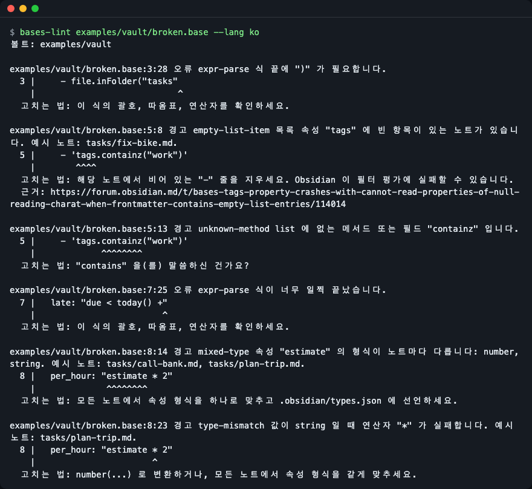
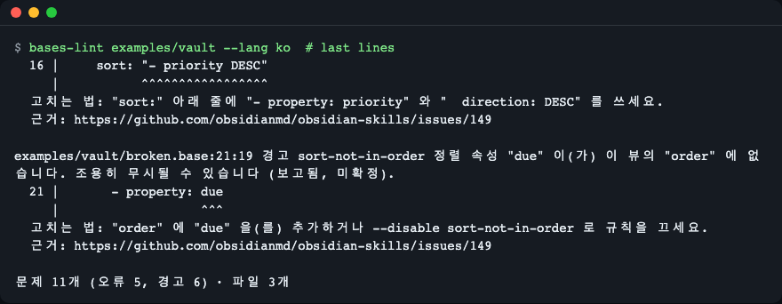
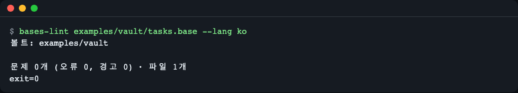
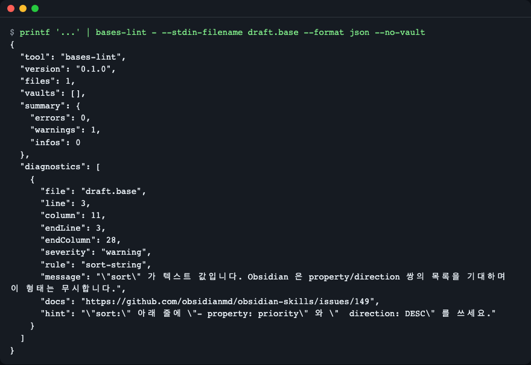
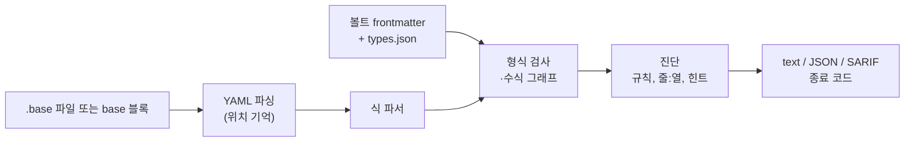

# bases-lint

[English](README.md) | **한국어**

Obsidian Bases 파일(`.base` 파일과 노트 안의 `base` 코드 블록)을 Obsidian 을 열지 않고 명령줄에서 검사합니다. 한 번 실행하면 식 문법 오류, 없는 함수·메서드, 형식 불일치, 조용히 무시되는 보기 설정을 모두 모아, 파일의 줄·열, 규칙 ID, 한 줄 해결법, 근거 링크와 함께 보여 줍니다.


*문제마다 정확한 줄·열, 코드 조각, 고치는 법이 나옵니다.*

> 비공식 도구입니다. Bases 식에는 공개된 공식 문법이 없어서, 규칙은 공개 도움말(2026-11-17 확인)을 따르며 일부러 보수적으로 만들었습니다. [한계](#한계)를 보세요.

## 이런 분께

- `.base` 파일을 직접 쓰면서, 깨진 보기를 하나씩 찾는 대신 실수를 한꺼번에 보고 싶은 분.
- 코딩 에이전트가 Bases 를 써 주는데, 수정할 때마다 돌릴 검사(JSON 출력, 종료 코드)가 필요한 분.
- 볼트를 Git 으로 관리하며 `tody()`·`file.nmae` 같은 오타를 pre-commit 이나 CI 에서 잡고 싶은 분.

## 설치

Node.js 22 이상(<https://nodejs.org/> 에서 설치하거나 `brew install node`)과 git 이 필요합니다. 아직 npm 레지스트리에 올라가 있지 않으니 clone 해서 쓰세요.

```bash
git clone https://github.com/LeeGyeongPil/bases-lint
cd bases-lint
npm ci
npm run build
```

`node dist/cli.js` 로 실행합니다(아래에서는 `bases-lint` 로 줄여 씁니다).

## 빠르게 시작하기

저장소에는 망가진 base 하나와 올바른 base 하나가 든 작은 볼트가 들어 있습니다.

```bash
node dist/cli.js examples/vault --lang ko; echo "exit=$?"
```

출력(줄임, 전체는 문제 11개):

```text
볼트: examples/vault

examples/vault/broken.base:3:28 오류 expr-parse 식 끝에 ")" 가 필요합니다.
  3 |     - file.inFolder("tasks"
    |                            ^
  고치는 법: 이 식의 괄호, 따옴표, 연산자를 확인하세요.

examples/vault/broken.base:5:13 경고 unknown-method list 에 없는 메서드 또는 필드 "containz" 입니다.
  5 |     - 'tags.containz("work")'
    |             ^^^^^^^^
  고치는 법: "contains" 을(를) 말씀하신 건가요?

...

문제 11개 (오류 5, 경고 6) · 파일 3개
exit=1
```


*마지막 줄: 합계와, 스크립트나 CI 가 보는 종료 코드.*

- `3:28` 은 파일의 3번째 줄 28번째 열이며, 따옴표로 감싼 YAML 문자열 안의 위치입니다.
- `오류` 는 그 base 가 동작할 수 없다는 뜻이고, `경고` 는 일부 노트나 미확정 동작에 따라 달라진다는 뜻입니다.
- 종료 코드 `1` 은 오류가 하나 이상이라는 뜻입니다. 깨끗한 base 는 `0` 으로 끝납니다.

```bash
node dist/cli.js examples/vault/tasks.base --lang ko
```

```text
볼트: examples/vault

문제 0개 (오류 0, 경고 0) · 파일 1개
```


*올바른 base 는 진단 없이 종료 코드 0 으로 끝납니다.*

## 사용법

| 명령·옵션 | 하는 일 | 예 |
|---|---|---|
| `<경로...>` | `.base` 파일, `base` 블록이 있는 노트, 폴더를 검사 | `bases-lint examples/vault` |
| `-` | 표준 입력에서 base 하나를 읽음 | `cat draft.base \| bases-lint -` |
| `--stdin-filename <이름>` | 표준 입력에 보여 줄 파일 이름 | `--stdin-filename draft.base` |
| `--format text\|json\|sarif` | 출력 형식(기본 `text`) | `--format json` |
| `--lang en\|ko` | 메시지 언어 | `--lang ko` |
| `--vault <폴더>` / `--no-vault` | 속성 검사에 쓸 볼트 지정 / 그 검사 건너뛰기 | `--vault ~/notes` |
| `--disable <규칙>` | 규칙 끄기(여러 번 가능) | `--disable mixed-type` |
| `--strict` | 경고에도 종료 코드 1 | `--strict` |
| `--exit-zero` | 문제가 있어도 0 으로 종료(사용법 오류는 2) | `--exit-zero` |
| `--rules` | 규칙 목록과 기본 심각도 | `bases-lint --rules` |
| `-h`, `--help` / `-v`, `--version` | 도움말 / 버전 | |

종료 코드: `0` 오류 없음, `1` 오류(`--strict` 면 경고 포함), `2` 명령줄 오류 또는 읽을 수 없는 경로.

규칙 18개와 예시는 [docs/rules.md](docs/rules.md) 에 있습니다(영어).

```text
yaml-syntax, top-level-key, view-shape, view-type-unknown, filter-shape, expr-parse,
unknown-function, unknown-method, wrong-arity, type-mismatch, formula-undefined,
formula-cycle, unknown-property, mixed-type, empty-list-item, sort-string,
sort-not-in-order, summary-unknown
```

### 파이프로 초안 검사(에이전트·에디터용)

```bash
printf 'views:\n  - type: table\n    sort: "- priority DESC"\n' \
  | node dist/cli.js - --stdin-filename draft.base --format json --no-vault --lang ko
```

```json
{
  "tool": "bases-lint",
  "version": "0.1.0",
  "files": 1,
  "vaults": [],
  "summary": { "errors": 0, "warnings": 1, "infos": 0 },
  "diagnostics": [
    {
      "file": "draft.base",
      "line": 3,
      "column": 11,
      "endLine": 3,
      "endColumn": 28,
      "severity": "warning",
      "rule": "sort-string",
      "message": "\"sort\" 가 텍스트 값입니다. Obsidian 은 property/direction 쌍의 목록을 기대하며 이 형태는 무시합니다.",
      "docs": "https://github.com/obsidianmd/obsidian-skills/issues/149",
      "hint": "\"sort:\" 아래 줄에 \"- property: priority\" 와 \"  direction: DESC\" 를 쓰세요."
    }
  ]
}
```

(실제 출력은 여러 줄로 들여써 나오며, 여기서는 `summary` 객체만 한 줄로 줄여 적었습니다.)


*`sort` 를 문자열 하나로 쓰면 YAML 은 받아 주지만 Obsidian 은 무시합니다. JSON 에 위치와 고치는 법이 담겨 에이전트가 바로 쓸 수 있습니다.*

### SARIF 와 노트

`--format sarif` 는 코드 스캔 도구용 SARIF 2.1.0 을 출력합니다. 노트 안의 `base` 코드 블록도 `.base` 파일과 같게 검사하며, 줄 번호는 노트 기준입니다.

````text
```base
filters: file.hasTag("book")
views:
  - type: cards
    name: Books
    order: [file.name, rating]
```
````

## 설정

| 설정 | 뜻 |
|---|---|
| `--lang en\|ko` | 메시지 언어, 가장 우선 |
| `BASES_LINT_LANG` | `en` 또는 `ko`, `--lang` 이 없을 때 사용 |
| `LC_ALL`, `LC_MESSAGES`, `LANG` | 그다음, 비어 있지 않은 첫 값. `ko` 로 시작하면 한국어, 아니면 영어 |
| `.obsidian/types.json` | 볼트에 있으면 선언한 속성 형식이 노트 frontmatter 추정보다 우선. 형식 `{"types": {"status": "text", "due": "date"}}` ([한계](#한계) 참고) |
| 볼트 | 각 파일에서 위로 올라가며 처음 만나는 `.obsidian` 이 있는 폴더, 없으면 넘긴 폴더. 파일 하나만 넘겼고 위에 `.obsidian` 이 없으면 볼트 없음. `--vault <폴더>` 로 지정, `--no-vault` 로 끔 |

JSON 키·규칙 ID·종료 코드는 언어와 무관합니다. 설정 파일은 아직 없습니다.

## 라이브러리로 쓰기

에디터 플러그인이나 에이전트 같은 자기 코드에서 검사기를 호출할 수 있습니다. npm 에 올라가기 전에는 clone 한 곳의 `dist/index.js` 를 import 하세요.

| 내보내는 것 | 하는 일 |
|---|---|
| `lintBase(source, options)` | 텍스트로 받은 base 하나를 검사해 진단 배열을 돌려줌 |
| `lintPaths(paths, options)` | 파일, `base` 블록이 든 노트, 폴더를 검사해 결과와 요약을 돌려줌 |
| `indexVault(dir)` | 노트 속성과 `.obsidian/types.json` 을 읽어 볼트 인덱스로 만듦 |
| `parseExpression(text)` | 식 하나를 문법 트리 또는 파싱 오류로 만듦 |
| `RULES` | 규칙 표(ID, 심각도, 문서 링크) |
| `BasesLintUsageError`, `RULE_IDS` | 사용법 오류 클래스와 규칙 ID 목록 |

최소 예제(저장소 루트에 `example.mjs` 로 저장):

```js
import { readFileSync } from "node:fs";
import { lintBase } from "./dist/index.js";

const source = readFileSync("test/fixtures/bad.base", "utf8");
const diags = lintBase(source, { file: "bad.base", lang: "en" });
for (const d of diags) console.log(`${d.line}:${d.column}`, d.severity, d.rule, d.message);
```

```text
3:28 error expr-parse Expected ")" at the end of the expression.
5:13 warning unknown-method Unknown method or field "containz".
7:21 error expr-parse Unexpected token "*".
8:10 error formula-cycle Formulas refer to each other in a loop: loop -> loop.
13:11 warning sort-string "sort" is a text value. Obsidian expects a list of property and direction pairs and ignores this form.
```

볼트가 없으면 `tags` 의 형식을 알 수 없습니다. 볼트 인덱스를 `vault` 옵션으로 넘기면(`lintBase(source, { vault: await indexVault(dir) })`) "for list" 처럼 형식을 짚은 메시지가 나옵니다. (이 예제는 `lang: "en"` 이라 메시지가 영어입니다. `lang: "ko"` 로 바꾸면 한국어로 나옵니다.)

## 동작 원리



1. 파일을 YAML 로 읽으면서 모든 글자의 위치를 기억합니다.
2. 식 문자열마다 토큰으로 나누고 파싱하며, 문자열 안의 위치를 파일의 줄·열로 되돌립니다(일반·따옴표·이스케이프·블록 스칼라).
3. 볼트 노트의 frontmatter(와 `.obsidian/types.json`)로 속성마다 가능한 형식을 정합니다.
4. 함수 호출, 메서드, 연산자, `formula.*` 참조를 알려진 함수 표([`src/signatures.json`](src/signatures.json), 출처·확인일 포함)와 맞춰 봅니다. base 를 실행하지 않고 검사만 합니다.
5. 첫 문제에서 멈추지 않고 모두 모아 고른 형식으로 출력합니다.

오류는 그 속성이 가질 수 있는 모든 형식에서 틀릴 때, 경고는 일부 노트에서만 틀릴 때입니다. 경고 메시지에는 예시 노트 이름이 나옵니다.

## 언제 쓰나

- 잘 맞는 때: 저장할 때, pre-commit·CI 에서, 에이전트가 base 를 고친 직후의 빠른 검사. 여러 `.base` 파일의 오타와 조용한 실패를 한꺼번에 찾기.
- 쿼리를 실행하거나 결과를 보여 주지 않습니다. base 가 무엇을 돌려주는지는 Obsidian 에서 여세요.
- 비슷한 일을 하는 다른 도구로 노트 서식용 [Obsidian Linter](https://github.com/platers/obsidian-linter) 등이 있습니다. 무엇을 다루는지는 해당 문서를 확인하세요.

오류 다섯 개를 심은 base 에 대안을 직접 돌려 관찰한 내용입니다(2026-11-17 확인, 도구는 바뀌므로 해당 문서를 확인하세요).

| 도구 | 관찰한 동작 | 출처 |
|---|---|---|
| [mdbasequery](https://github.com/intellectronica/mdbasequery) 0.0.3 | 질의 엔진. 첫 오류에서 멈추고, 위치는 파일 줄이 아니라 식 안의 offset | npm `mdbasequery` |
| [obsidian-everywhere](https://glama.ai/mcp/servers/junnnnnw00/obsidian-everywhere/tools/validate_base) 의 `validate_base` | YAML 과 키 구조를 검사하고, 식의 의미는 Obsidian 에 맡김 | Glama 도구 페이지 |
| [obsidian-skills](https://github.com/obsidianmd/obsidian-skills) `obsidian-bases` | base 작성법 문서이며 검사기가 아님 | 저장소 |

## 자주 겪는 문제

| 증상 | 원인 | 해결 |
|---|---|---|
| 내 컴퓨터에서 출력이 한국어로 나옴 | `LANG` 이 `ko` 로 시작 | `--lang en` 또는 `BASES_LINT_LANG=en` |
| 볼트 기반 경고가 안 나옴 | 파일 하나만 넘겼는데 위에 `.obsidian` 폴더가 없음 | `--vault <폴더>` 를 주거나 폴더를 넘기세요 |
| stderr 에 `types.json` 관련 `note:` 한 줄 | `{"types": {...}}` 형식으로 읽지 못함 | 파일을 고치세요. 그동안은 frontmatter 추정으로 대체됩니다 |
| 있는 메서드인데 경고가 나옴 | 플러그인 함수는 아직 등록할 수 없음 | `--disable unknown-method` |
| `sort-not-in-order` 가 이상함 | 보고됐지만 미확정인 동작 | `--disable sort-not-in-order` |
| `npm start` 가 진단은 출력하는데 오류 표시가 없음 | `npm start` 는 예시 볼트를 `--exit-zero` 로 실행 | 종료 코드 1 을 보려면 `node dist/cli.js` |

## 한계

- 비공식입니다. 문법·함수 도움말(2026-11-17 확인) 기준: <https://obsidian.md/help/bases/syntax>, <https://obsidian.md/help/bases/functions>.
- 위의 `.obsidian/types.json` 형식은 실제 Obsidian 이 만든 파일로 확인하지 못했습니다.
- 기간 문자열, `link` 필드, 객체 속성의 하위 키는 검사하지 않습니다.
- 플러그인이 제공하는 함수는 아직 등록할 수 없습니다.

## 개발

```bash
npm ci
npm run build
npm test
```

버그·제안은 이슈로 남겨 주세요. 변경 기록은 [CHANGELOG.md](CHANGELOG.md).

## 라이선스

MIT
