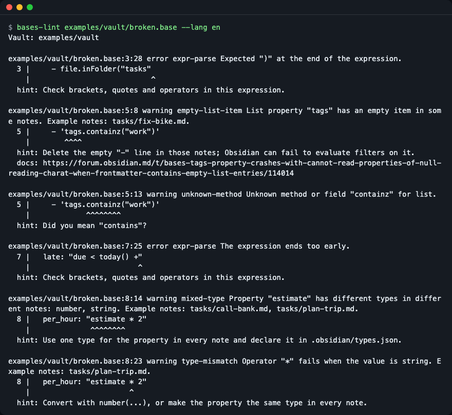
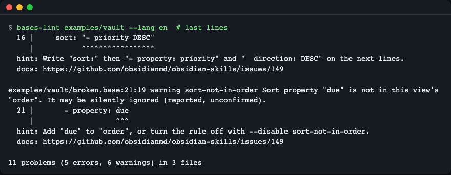
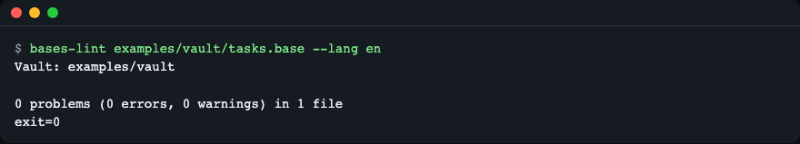
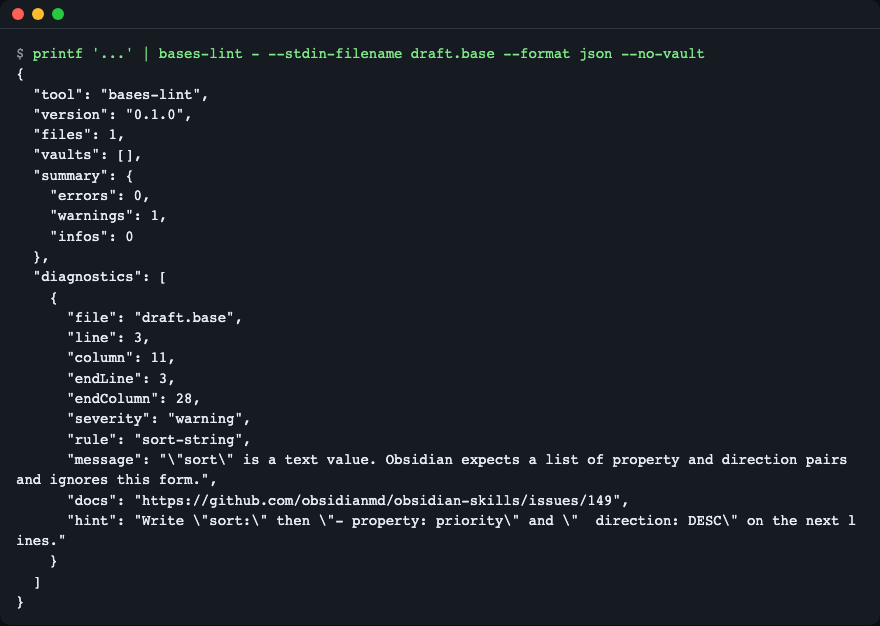
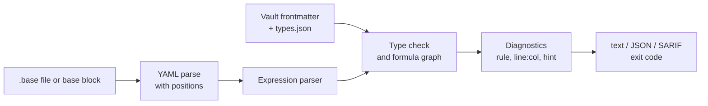

# bases-lint

**English** | [한국어](README.ko.md)

Check Obsidian Bases files (`.base` files and `base` code blocks in notes) from the command line, without opening Obsidian. One run lists every expression syntax error, unknown function or method, type mismatch and silently ignored view setting, each with the file line and column, a rule ID, a one-line fix and an evidence link.


*Each problem shows the exact line and column, a code frame, and a hint on how to fix it.*

> Unofficial tool. Obsidian has no published grammar for Bases expressions, so the rules follow the public help pages (checked 2026-11-17) and are deliberately conservative. See [Limits](#limits).

## Who this is for

- You write `.base` files by hand and want to see all mistakes at once instead of one broken view at a time.
- A coding agent writes Bases for you and you want a check it can run after each edit (JSON output, exit codes).
- You keep a vault in Git and want a pre-commit or CI step that catches a typo like `tody()` or `file.nmae` before it reaches your notes.

## Install

Needs Node.js 22 or newer (install from <https://nodejs.org/> or `brew install node`) and git. The package is not on the npm registry yet, so use a clone:

```bash
git clone https://github.com/LeeGyeongPil/bases-lint
cd bases-lint
npm ci
npm run build
```

Run it with `node dist/cli.js` (written as `bases-lint` below).

## Quick start

The repository ships a small vault with one broken base and one valid base:

```bash
node dist/cli.js examples/vault --lang en; echo "exit=$?"
```

Output (shortened; the full run prints 11 problems):

```text
Vault: examples/vault

examples/vault/broken.base:3:28 error expr-parse Expected ")" at the end of the expression.
  3 |     - file.inFolder("tasks"
    |                            ^
  hint: Check brackets, quotes and operators in this expression.

examples/vault/broken.base:5:13 warning unknown-method Unknown method or field "containz" for list.
  5 |     - 'tags.containz("work")'
    |             ^^^^^^^^
  hint: Did you mean "contains"?

...

11 problems (5 errors, 6 warnings) in 3 files
exit=1
```


*The last lines: totals, then the exit code your script or CI sees.*

- `3:28` is line 3, column 28 of the file, inside a quoted YAML string.
- `error` means the base cannot work; `warning` means it depends on some notes or on unconfirmed behavior.
- Exit code `1` means at least one error. A clean base exits `0`:

```bash
node dist/cli.js examples/vault/tasks.base --lang en
```

```text
Vault: examples/vault

0 problems (0 errors, 0 warnings) in 1 file
```


*A valid base prints no diagnostics and exits 0.*

## Usage

| Command or option | What it does | Example |
|---|---|---|
| `<path...>` | Check `.base` files, notes with `base` blocks, or folders | `bases-lint examples/vault` |
| `-` | Read one base from standard input | `cat draft.base \| bases-lint -` |
| `--stdin-filename <name>` | Name shown for standard input | `--stdin-filename draft.base` |
| `--format text\|json\|sarif` | Output format (default `text`) | `--format json` |
| `--lang en\|ko` | Message language | `--lang ko` |
| `--vault <dir>` / `--no-vault` | Pick the vault for property checks, or skip those checks | `--vault ~/notes` |
| `--disable <rule>` | Turn a rule off (repeatable) | `--disable mixed-type` |
| `--strict` | Exit 1 on warnings too | `--strict` |
| `--exit-zero` | Exit 0 even with problems (usage errors still exit 2) | `--exit-zero` |
| `--rules` | List the rules and their default severity | `bases-lint --rules` |
| `-h`, `--help` / `-v`, `--version` | Help / version | |

Exit codes: `0` no errors, `1` errors (or warnings with `--strict`), `2` bad command line or unreadable path.

The 18 rules are listed with examples in [docs/rules.md](docs/rules.md):

```text
yaml-syntax, top-level-key, view-shape, view-type-unknown, filter-shape, expr-parse,
unknown-function, unknown-method, wrong-arity, type-mismatch, formula-undefined,
formula-cycle, unknown-property, mixed-type, empty-list-item, sort-string,
sort-not-in-order, summary-unknown
```

### Check a draft from a pipe (for agents and editors)

```bash
printf 'views:\n  - type: table\n    sort: "- priority DESC"\n' \
  | node dist/cli.js - --stdin-filename draft.base --format json --no-vault --lang en
```

```json
{
  "tool": "bases-lint",
  "version": "0.1.0",
  "files": 1,
  "vaults": [],
  "summary": { "errors": 0, "warnings": 1, "infos": 0 },
  "diagnostics": [
    {
      "file": "draft.base",
      "line": 3,
      "column": 11,
      "endLine": 3,
      "endColumn": 28,
      "severity": "warning",
      "rule": "sort-string",
      "message": "\"sort\" is a text value. Obsidian expects a list of property and direction pairs and ignores this form.",
      "docs": "https://github.com/obsidianmd/obsidian-skills/issues/149",
      "hint": "Write \"sort:\" then \"- property: priority\" and \"  direction: DESC\" on the next lines."
    }
  ]
}
```

(The real output is pretty-printed over more lines; it is shown here with the `summary` object on one line.)


*`sort` written as one string is accepted by YAML but ignored by Obsidian; the JSON gives an agent the position and the fix.*

### SARIF and notes

`--format sarif` prints SARIF 2.1.0 for code-scanning tools. A `base` code block inside a note is checked the same way as a `.base` file, with line numbers counted in the note:

````text
```base
filters: file.hasTag("book")
views:
  - type: cards
    name: Books
    order: [file.name, rating]
```
````

## Configuration

| Setting | Meaning |
|---|---|
| `--lang en\|ko` | Highest priority for the message language |
| `BASES_LINT_LANG` | `en` or `ko`; used when `--lang` is not given |
| `LC_ALL`, `LC_MESSAGES`, `LANG` | Used next, first non-empty value; a value starting with `ko` gives Korean, anything else English |
| `.obsidian/types.json` | If the vault has it, declared property types win over types guessed from note frontmatter. Format `{"types": {"status": "text", "due": "date"}}` (see [Limits](#limits)) |
| Vault | The nearest folder above each file that contains `.obsidian`; if none, the folder you passed. A single file with no `.obsidian` above it gets no vault. `--vault <dir>` overrides, `--no-vault` turns vault checks off |

JSON keys, rule IDs and exit codes do not change with the language. There is no configuration file yet.

## Library API

You can call the checker from your own code, for example an editor plugin or an agent. Until the package is on npm, import it from the clone (`dist/index.js`).

| Export | What it does |
|---|---|
| `lintBase(source, options)` | Check one base given as text; returns an array of diagnostics |
| `lintPaths(paths, options)` | Check files, notes with `base` blocks and folders; returns results and a summary |
| `indexVault(dir)` | Read note properties and `.obsidian/types.json` into a vault index |
| `parseExpression(text)` | Parse one expression into a syntax tree or a parse error |
| `RULES` | The rule table (ID, severity, docs link) |
| `BasesLintUsageError`, `RULE_IDS` | The usage error class and the list of rule IDs |

Minimal example (saved as `example.mjs` in the repository root):

```js
import { readFileSync } from "node:fs";
import { lintBase } from "./dist/index.js";

const source = readFileSync("test/fixtures/bad.base", "utf8");
const diags = lintBase(source, { file: "bad.base", lang: "en" });
for (const d of diags) console.log(`${d.line}:${d.column}`, d.severity, d.rule, d.message);
```

```text
3:28 error expr-parse Expected ")" at the end of the expression.
5:13 warning unknown-method Unknown method or field "containz".
7:21 error expr-parse Unexpected token "*".
8:10 error formula-cycle Formulas refer to each other in a loop: loop -> loop.
13:11 warning sort-string "sort" is a text value. Obsidian expects a list of property and direction pairs and ignores this form.
```

Without a vault the type of `tags` is unknown; pass a vault index as the `vault` option (`lintBase(source, { vault: await indexVault(dir) })`) to get type-aware messages such as "for list".

## How it works



1. The file is parsed as YAML while remembering where every character sits.
2. Each expression string is tokenized and parsed, mapping an offset inside the string back to a file line and column (plain, quoted, escaped and block scalars).
3. The vault's note frontmatter (and `.obsidian/types.json`) gives each property its possible types.
4. Calls, methods, operators and `formula.*` references are checked against a table of known functions ([`src/signatures.json`](src/signatures.json), with sources and check date). It checks, not runs, the base.
5. All problems are collected, not just the first, and printed in the chosen format.

An error means the value is wrong for every possible type of the property. A warning means it is wrong for some notes, in which case the message names example notes.

## When to use it

- Good fit: a quick check on save, in pre-commit or CI, or after an agent edits a base; finding typos and silent failures in many `.base` files at once.
- It does not run queries or show results. To see what a base returns, open it in Obsidian.
- Other tools exist for related jobs, for example [Obsidian Linter](https://github.com/platers/obsidian-linter) for note formatting. Check their documentation for what they cover.

What I observed when trying the alternatives on a base with five planted errors (checked 2026-11-17; tools change, so check their docs):

| Tool | Observed behavior | Source |
|---|---|---|
| [mdbasequery](https://github.com/intellectronica/mdbasequery) 0.0.3 | A query engine. Stopped at the first error; positions are offsets inside the expression, not file lines | npm `mdbasequery` |
| `validate_base` in [obsidian-everywhere](https://glama.ai/mcp/servers/junnnnnw00/obsidian-everywhere/tools/validate_base) | Checks YAML and key structure; leaves expression meaning to Obsidian | Glama tool page |
| [obsidian-skills](https://github.com/obsidianmd/obsidian-skills) `obsidian-bases` | Documentation for writing bases, not a checker | repository |

## Troubleshooting

| Symptom | Cause | Fix |
|---|---|---|
| Output is Korean on my machine | Your `LANG` starts with `ko` | Add `--lang en` or set `BASES_LINT_LANG=en` |
| No vault-based warnings | A single file argument has no `.obsidian` folder above it | Pass `--vault <dir>` or check the folder |
| `note:` line on stderr about `types.json` | The file could not be read as `{"types": {...}}` | Fix the file; the tool falls back to guessing from frontmatter |
| Warning about a method you know exists | Plugin-provided functions cannot be registered yet | `--disable unknown-method` |
| `sort-not-in-order` seems wrong | The behavior is reported but unconfirmed | `--disable sort-not-in-order` |
| `npm start` prints diagnostics but no error | `npm start` runs the example vault with `--exit-zero` | Use `node dist/cli.js` to get exit code 1 |

## Limits

- Unofficial. Based on the Obsidian help pages for syntax and functions (checked 2026-11-17): <https://obsidian.md/help/bases/syntax>, <https://obsidian.md/help/bases/functions>.
- The `.obsidian/types.json` format above was not checked against a file written by a real Obsidian.
- Duration strings, `link` fields and keys inside object properties are not checked.
- Plugin-provided functions cannot be registered yet.

## Development

```bash
npm ci
npm run build
npm test
```

Bugs and ideas are welcome as issues. Changes are listed in [CHANGELOG.md](CHANGELOG.md).

## License

MIT
